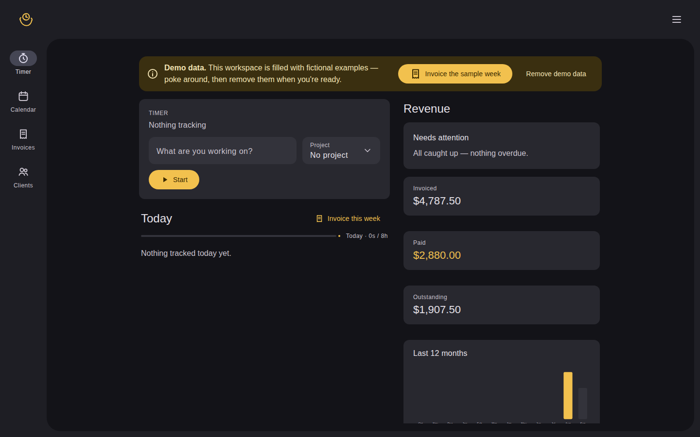
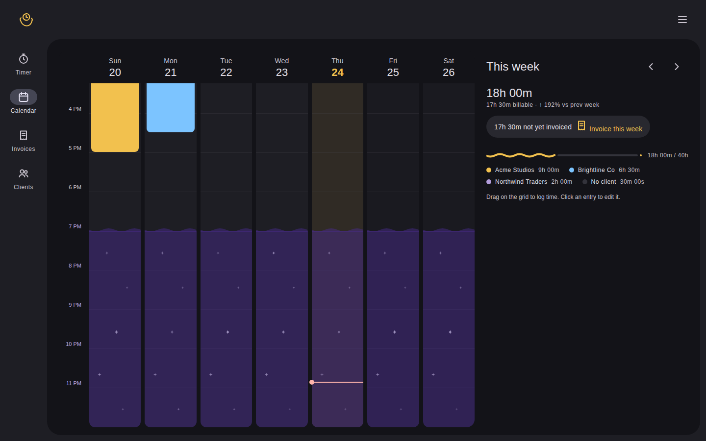
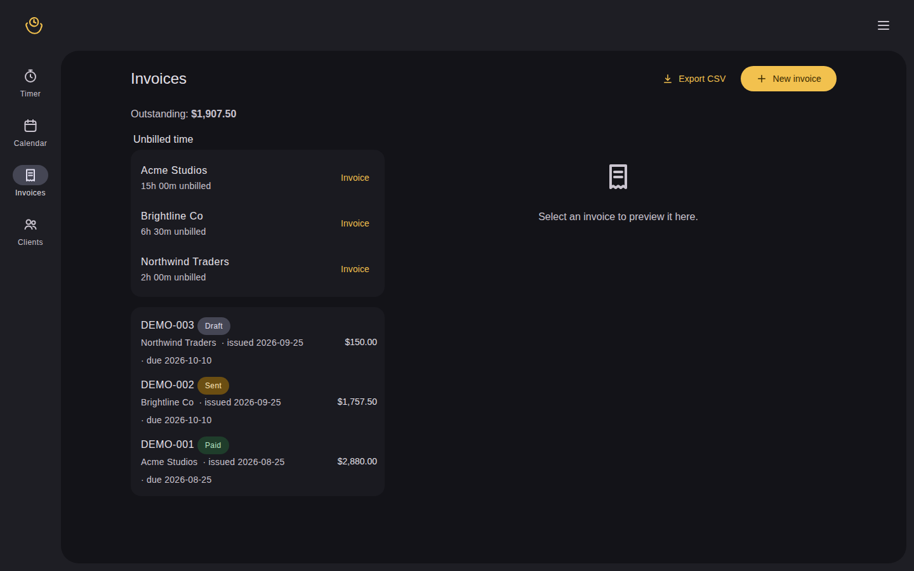

<div align="center">


# Zimer

Self-hostable time tracker — timer → invoice. One Bun server, one SQLite file, your data never leaves the machine.

[](https://bun.sh)
[](https://htmx.org)
[](https://sqlite.org)
[](LICENSE)

</div>

<details>
<summary><kbd>Table of contents</kbd></summary>

- [Features](#features)
- [Screenshots](#screenshots)
- [Install](#install)
- [Quickstart](#quickstart)
- [Browser extension](#browser-extension)
- [Config](#config)
- [Notes](#notes)
- [Layout](#layout)
- [Development](#development)
- [Docs](#docs)
- [License](#license)

</details>

## Features

- **Timer** — one-tap start/stop, live elapsed, notes, projects.
- **Calendar** — Toggl-style week grid, drag to create entries, edit in place.
- **Invoicing** — pick a date range, edit line items, draft → sent → paid, download the PDF. Sent invoices are frozen snapshots.
- **Revenue** — totals, trailing-12-month chart, per-client breakdown.
- **Public invoice links** — read-only shareable page per invoice (optional Stripe payment link).
- **Browser extension** — start/stop timers from the Chrome / Edge / Brave toolbar, no build step.
- **Check for updates** — in-app, from the signed release feed.
- Your data is one SQLite file. Back it up, move it, done.

## Screenshots

*All screenshots use fictional demo data — the app ships with a one-click sample workspace.*

**Timer** — start/stop card, today's entries, live revenue pane.



**Calendar** — week grid with entries, per-day totals, this-week summary.



**Invoices** — unbilled time per client, draft → sent → paid pipeline.



## Install

Needs [Bun](https://bun.sh), `curl`, `tar`, `sha256sum`. Installs to `/opt/timekeep` (needs root; set `INSTALL_DIR` to change).

```sh
curl -fsSL https://invoices.tristonarmstrong.com/releases/install.sh | bash
# re-running the same command updates to the latest v1 release —
# data, token, and start.sh are preserved
```

## Quickstart

From source:

```sh
bun run ./site/server.ts
# -> http://127.0.0.1:3000
```

First run prints your API token — save it; the login page and the extension both need it. Binds localhost only by default; set `HOST`/`PORT` to change that.

## Browser extension

Chrome / Edge / Brave:

1. `chrome://extensions` → enable Developer mode → "Load unpacked" → the `extension/` folder.
2. Click the Zimer icon → enter your site URL (e.g. `http://localhost:3000`) and the API token → Save.
3. Start/stop timers from the popup. They show up on the site's calendar.

## Config

| Var                            | Default        | What                                          |
|--------------------------------|----------------|-----------------------------------------------|
| `PORT`                         | `3000`         | HTTP port                                     |
| `HOST`                         | `127.0.0.1`    | bind address                                  |
| `DATA_DIR`                     | `site/data`    | SQLite file + token live here                 |
| `TIMEKEEP_TOKEN`               | auto-generated | shared secret for API + login                 |

## Notes

- Times are stored as UTC ISO strings; the site renders them in the server's local timezone. If you host on a VPS in another timezone, set `TZ` for the process (e.g. `TZ=America/Chicago bun run ./site/server.ts`).
- Back up `data/timekeep.db` — that's the entire app state.

## Layout

```
zimer/
├── AGENTS.md            # the always-known rules: Bun-only, M3 dark, workflows
├── PLAN.md              # the plan: architecture, API contract, milestones
├── CHANGELOG.md         # what's new, newest first
├── LICENSE              # MIT
├── VERSION
├── install.sh           # one-command install / updater
├── site/
│   ├── server.ts        # entry: HTTP server + SQLite
│   ├── db.ts            # schema + migrations
│   ├── pdf.ts           # zero-dependency PDF writer
│   ├── stripe.ts        # optional Stripe payment link on invoices
│   ├── routes/          # web.ts (HTMX pages), api.ts (JSON API)
│   ├── views/           # timer, calendar, invoices, manage, public pages
│   ├── lib/             # auth, revenue, icons, updates, ...
│   └── static/          # style.css, dialog.js, shortcut.js, ...
└── extension/           # Manifest V3, no build step: manifest.json, popup.html, popup.js, bg.js
```

## Development

Bun only — no npm/npx/yarn/pnpm/Docker.

```sh
bun test        # must finish with 0 failures
```

Every change goes issue → early PR → test evidence → merge. See [docs/workflow.md](docs/workflow.md).

## Docs

- [AGENTS.md](AGENTS.md) — architecture, hard rules, design philosophy, settled decisions, workflows
- [docs/design-system.md](docs/design-system.md) — the M3 Expressive spec the UI follows
- [docs/workflow.md](docs/workflow.md) — the issue → PR change process
- [PLAN.md](PLAN.md) — original plan: architecture, API contract, milestones
- [CHANGELOG.md](CHANGELOG.md) — release notes

## License

[MIT](LICENSE) © 2026 tristonarmstrong
